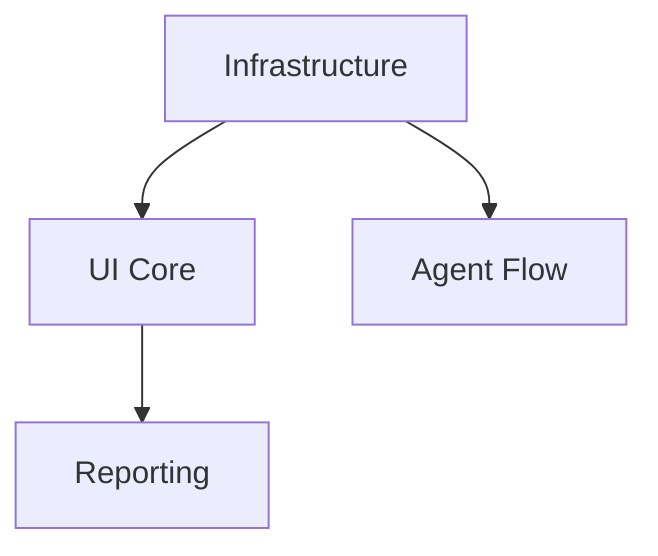
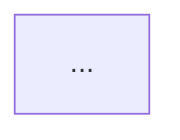

# Plan — Analyse préalable des issues

## 1. Analyse du problème

### Situation actuelle
- Les issues GitHub sont affichées dans `IssueList.svelte` sous forme de **liste plate** (number, title, labels, state)
- `GET /api/issues` retourne uniquement les métadonnées de base : pas de `body`
- Il n'existe aucune vue thématique, ni diagramme d'ordre d'implémentation
- L'utilisateur doit ouvrir chaque issue manuellement pour en comprendre la portée

### Besoin
Permettre à Claudicator d'analyser l'ensemble des issues pour :
1. Les **regrouper par thèmes** (feature, bug, infrastructure, UI, etc.)
2. Déduire un **ordre d'implémentation recommandé** (dépendances logiques entre groupes)
3. Visualiser le résultat sous forme d'un **diagramme** lisible dans l'interface
4. **Mémoriser** le résultat et signaler les changements sans re-analyser automatiquement
5. **Convertir** chaque issue analysée en Task Claudicator

### Format de sortie attendu
Un rapport Markdown structuré avec un diagramme Mermaid `graph TD` (sans notion de temps) :

```markdown
## Analyse thématique

### Groupe 1 — Infrastructure
Issues : #1, #3
Résumé : ...

### Groupe 2 — UI Core
Issues : #2, #7
Dépend de : Groupe 1

## Roadmap recommandée


```

---

## 2. Localisation des usages

### Fichiers concernés

| Fichier | Rôle | Impact |
|---|---|---|
| `src/lib/server/services/github.ts` | `getIssues()` → retourne issues sans body | Ajouter `getIssuesWithBodies()` |
| `src/routes/api/issues/+server.ts` | `GET /api/issues` → liste plate | Aucun changement (rétrocompat) |
| `src/routes/api/agent/run/+server.ts` | Pattern SSE pour spawn Claude | Référence pour le nouvel endpoint |
| `src/lib/server/agent/prompt.ts` | `formatPrompt()` → prompt task standard | Créer un `buildAnalysisPrompt()` distinct |
| `src/lib/components/IssueList.svelte` | Liste des issues + bouton select | Ajouter bouton "Analyser" + badge de changements |
| `src/lib/components/RunConsole.svelte` | Console temps réel SSE | Réutiliser pour l'analyse |
| `src/lib/stores/agent.ts` | `agentState` (issue sélectionnée, plan…) | Ajouter `issueAnalysis` store |
| `src/routes/+page.svelte` | Layout global (aside / main / section) | Conditionner `main` pour afficher l'analyse |

### Ce qui n'existe pas encore
- `src/routes/api/issues/analyze/+server.ts` — endpoint d'analyse SSE
- `src/routes/api/issues/snapshot/+server.ts` — endpoint lecture/écriture snapshot
- `src/lib/server/agent/issue-analysis.ts` — formateur de prompt
- `src/lib/components/IssueAnalysis.svelte` — visualisation diagramme + actions

### Nouveaux fichiers de persistance
- `.agent/analysis.md` — dernier résultat produit par Claude (écrasé à chaque nouvelle analyse)
- `.agent/analysis-snapshot.json` — liste des issues (number, title, updatedAt) ayant servi à la dernière analyse

---

## 3. Stratégie

### Approche en 4 phases

**Phase A — Collecte enrichie avec résumé préalable**

Récupérer les bodies de toutes les issues avant d'envoyer à Claude.

- `getIssuesWithBodies(owner, repo)` dans `github.ts` — retourne `number, title, body, labels, updatedAt`
- **Seuil de longueur** : si un body dépasse 1 500 caractères, il est trop long pour être inclus tel quel
- **Résumé préalable** : pour chaque issue dépassant le seuil, effectuer un appel Claude séparé (`claude -p --verbose`) pour obtenir un résumé en 3-5 phrases condensant les points importants — jamais une troncature brute
- Raison : une troncature peut éliminer un détail décisif (contrainte technique, dépendance, cas limite) ; un résumé conserve l'essentiel
- Le résumé est utilisé uniquement pour le prompt d'analyse, pas stocké séparément

**Phase B — Analyse Claude via SSE**

Réutiliser exactement le pattern de `run/+server.ts` (spawn + SSE) sans task associée.

- `POST /api/issues/analyze` → spawn `claude -p --verbose --dangerously-skip-permissions`
- Prompt construit depuis `issue-analysis.ts` avec la liste enrichie (bodies ou résumés)
- À la fermeture du stream :
  - Sauvegarder le résultat dans `.agent/analysis.md`
  - Sauvegarder la snapshot dans `.agent/analysis-snapshot.json` (liste des issues utilisées : number, title, updatedAt)

**Phase C — Mémoire et détection de changements**

Claudicator mémorise l'état des issues au moment de la dernière analyse.

- Au chargement des issues, comparer la liste actuelle avec `analysis-snapshot.json` :
  - **Nouvelles issues** : présentes dans la liste actuelle, absentes de la snapshot
  - **Issues fermées** : présentes dans la snapshot, absentes de la liste actuelle
  - **Issues modifiées** : `updatedAt` plus récent que lors de la snapshot
- Afficher un **badge de changements** dans le header de `IssueList` : `"3 issues ont changé depuis la dernière analyse"`
- Le bouton "Analyser" affiche `"Mettre à jour l'analyse"` si un résultat existe, `"Analyser"` sinon
- **Jamais de mise à jour automatique** : l'utilisateur décide quand relancer

**Phase D — Conversion en Tasks**

Après affichage du résultat, proposer de créer les tasks correspondantes.

- En bas du composant `IssueAnalysis.svelte` : bouton `"Créer les tasks (N issues)"`
- Ce bouton appelle `POST /api/tasks` pour chaque issue de la liste analysée (en parallèle, avec dédoublonnage si la task existe déjà via `issueNumber`)
- Chaque task créée reçoit le titre de l'issue et son `issueNumber`
- Un feedback visuel indique les tasks créées / déjà existantes
- Si une task existe déjà pour une issue donnée, elle est ignorée (pas de doublon)

---

## 4. Étapes de modification du code

### Étape 1 — `github.ts` : ajouter `getIssuesWithBodies`

```typescript
export async function getIssuesWithBodies(owner: string, repo: string): Promise<Array<{
    number: number;
    title: string;
    body: string | null;
    labels: string[];
    updatedAt: string;
}>> {
    const octokit = getOctokit();
    const { data } = await octokit.issues.listForRepo({
        owner, repo, state: "open", per_page: 100
    });
    return data.map(i => ({
        number:    i.number,
        title:     i.title,
        body:      i.body ?? null,
        labels:    i.labels.map(l => typeof l === "string" ? l : (l.name ?? "")),
        updatedAt: i.updated_at,
    }));
}
```

**Aucune modification des fonctions existantes.**

---

### Étape 2 — `issue-analysis.ts` : formateur de prompt

Nouveau fichier `src/lib/server/agent/issue-analysis.ts`.

Deux fonctions :

**`summarizeIssueBody(body: string): Promise<string>`**
Appelle `claude -p --verbose` avec le body d'une issue et retourne un résumé en 3-5 phrases.
Utilisé uniquement pour les bodies > 1 500 caractères.

**`buildAnalysisPrompt(issues)`**
Construit le prompt d'analyse à partir de la liste enrichie.
Format :
```
TASK
Analyse et organisation des issues GitHub

OBJECTIF
Analyser les issues listées ci-dessous et produire :
1. Un regroupement thématique (5 groupes max)
2. Un ordre d'implémentation recommandé (dépendances logiques)
3. Un diagramme Mermaid graph TD représentant l'ordre

CONTRAINTES
- Pas de notion de temps ou de durée
- Grouper par logique fonctionnelle (infrastructure, UI, agent, intégration…)
- Identifier les dépendances entre groupes
- Garder les titres des groupes courts (3-4 mots max)
- Inclure tous les numéros d'issues dans au moins un groupe

FORMAT DE SORTIE
## Analyse thématique
### Groupe N — Nom
Issues : #X, #Y
Résumé : <1 phrase>
Dépend de : <Groupe X si applicable>

## Roadmap recommandée


ISSUES
#1 — Titre
Labels : label1, label2
Description : <body ou résumé>

#2 — Titre
...
```

---

### Étape 3 — `src/routes/api/issues/analyze/+server.ts`

Pattern identique à `run/+server.ts` **sans task associée**.

```
POST /api/issues/analyze
→ getIssuesWithBodies()
→ Pour chaque issue avec body > 1 500 chars : summarizeIssueBody()
→ buildAnalysisPrompt()
→ spawn claude -p --verbose --dangerously-skip-permissions (stdin = prompt)
→ SSE stream ligne par ligne
→ À la fermeture (success) :
    - écrire .agent/analysis.md
    - écrire .agent/analysis-snapshot.json (number, title, updatedAt pour chaque issue)
```

Différences vs `run/+server.ts` :
- Pas de `taskId`, pas de `register/unregister`
- Sauvegarde dans `.agent/analysis.md` et `.agent/analysis-snapshot.json`
- Endpoint `POST` sans body requis (owner/repo depuis `getCurrentProject()`)

---

### Étape 4 — `src/routes/api/issues/snapshot/+server.ts`

Route légère pour comparer l'état actuel des issues avec la snapshot.

```
GET /api/issues/snapshot
→ Lit .agent/analysis-snapshot.json (null si absent)
→ Retourne { snapshot: IssueSnapshot[] | null }
```

Utilisée par `IssueList.svelte` au chargement pour calculer le badge de changements.

---

### Étape 5 — `src/lib/stores/agent.ts` : ajouter `issueAnalysis`

```typescript
export const issueAnalysis = writable<{
    running: boolean;
    result: string | null;   // contenu de .agent/analysis.md
    logs: string[];
    snapshotDiff: {
        added: number[];     // issues nouvelles depuis la snapshot
        removed: number[];   // issues fermées depuis la snapshot
        modified: number[];  // issues modifiées depuis la snapshot
    } | null;
}>({ running: false, result: null, logs: [], snapshotDiff: null });
```

Store séparé de `agentRunState` pour ne pas entrer en conflit avec l'exécution normale d'une task.

---

### Étape 6 — `IssueList.svelte` : bouton + badge de changements

**Au `onMount`** :
1. Charger `GET /api/issues/snapshot` → snapshot existante ou null
2. Si snapshot : comparer avec les issues chargées → calculer `snapshotDiff`
3. Mettre à jour `issueAnalysis` store avec le diff

**Dans le template** :

Badge de changements (si `snapshotDiff` non null et non vide) :
```
⚠ 2 nouvelles · 1 fermée depuis la dernière analyse
```

Bouton dans le header :
```
[⊞ Analyser]           ← si pas de résultat
[⟳ Mettre à jour]     ← si résultat existant
```
Désactivé si `$agentRunState.running` (un run de task est en cours).

---

### Étape 7 — `IssueAnalysis.svelte` : visualisation + actions

Composant affiché dans la zone `main`.

**Si analyse en cours** : console de logs temps réel (même pattern que `RunConsole`)

**Si résultat disponible** :
- Rendu Markdown du résultat
- Extraction et rendu du bloc Mermaid (via `mermaid.js`)
- Bouton `"Créer les tasks (N issues)"` en bas
  - Appels `POST /api/tasks` pour chaque issue (dédoublonnage par `issueNumber`)
  - Feedback : `"12 tasks créées, 3 existaient déjà"`

---

### Étape 8 — `+page.svelte` : intégration dans la zone main

```svelte
<main>
    {#if $issueAnalysis.running || $issueAnalysis.result}
        <IssueAnalysis />
    {:else if $agentRunState.taskId}
        <RunConsole />
    {:else}
        <AgentConsole />
    {/if}
</main>
```

---

## 5. Vérifications et nettoyage final

### Rétrocompatibilité
- [ ] `GET /api/issues` inchangé → `IssueList.svelte` continue de fonctionner
- [ ] `getIssues()` dans `github.ts` inchangé → aucun import cassé
- [ ] `agentRunState` inchangé → `RunConsole` et `TaskList` non impactés

### Risques à surveiller
- **Résumé préalable** : si de nombreuses issues sont longues, les appels de résumé s'additionnent — les traiter en parallèle (`Promise.all`) avec une limite de concurrence (max 5 en parallèle)
- **Quota GitHub API** : 1 seul appel `listForRepo` pour toutes les issues. OK.
- **Streams concurrents** : désactiver "Analyser" si `agentRunState.running` est vrai
- **Mermaid rendu** : détecter le bloc ` ```mermaid ``` ` et l'extraire du Markdown avant rendu
- **Dédoublonnage tasks** : `createTask` existant gère déjà le cas `issueNumber` existant — réutiliser ce comportement

### Tests manuels à effectuer
1. Cliquer "Analyser" → stream SSE visible, logs en temps réel
2. Vérifier `.agent/analysis.md` et `.agent/analysis-snapshot.json` écrits après la fin
3. Fermer une issue sur GitHub, recharger → badge de changements affiché
4. Cliquer "Créer les tasks" → tasks créées, dédoublonnage fonctionnel
5. Relancer une analyse → résultat précédent écrasé, snapshot mise à jour
6. Lancer une task normale pendant l'analyse → pas de conflit de store

### Fichiers à ajouter au `.gitignore`
```
.agent/analysis.md
.agent/analysis-snapshot.json
```
